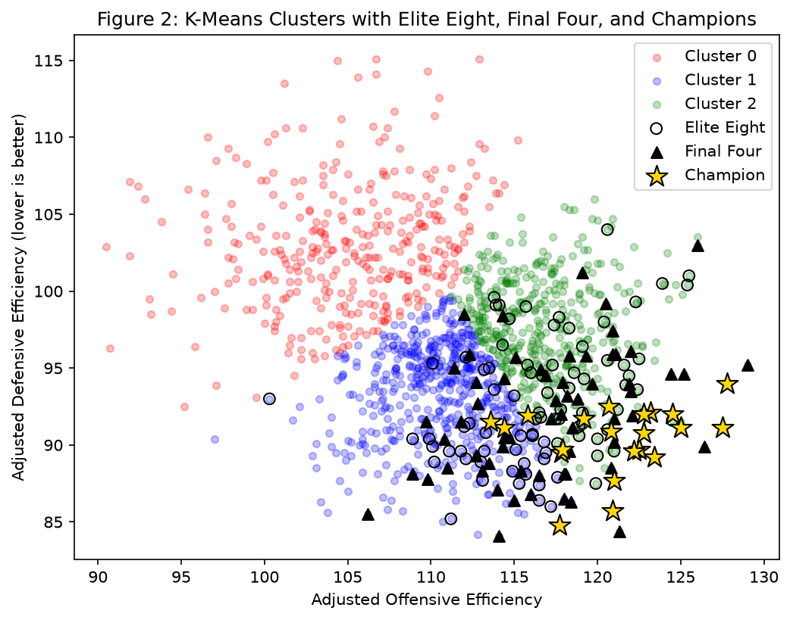

# Predicting March Madness Success

Can a college basketball team's **offense and defense numbers** tell you how far it will go in March Madness?

This is a rebuild of my CPSC 4300 data science course project. It uses 21 NCAA men's tournaments
(2003–2024, no 2020 tournament) and two KenPom stats:
**adjusted offensive efficiency** (points scored per 100 possessions) and **adjusted defensive efficiency**
(points allowed per 100 possessions), both adjusted for opponent strength.



## What I did
1. **Cleaned the data:** narrowed ~7,300 Division I team-seasons down to the 1,402 tournament teams, and
   marked which ones reached the Elite Eight, Final Four, or won it all.
2. **K-Means clustering (unsupervised):** grouped teams into 3 clusters using only offense and defense,
   then checked where the successful teams landed.
3. **Logistic regression (supervised):** three models estimating the probability of reaching the
   Elite Eight, the Final Four, or winning the title.

## Results (from running this notebook)
- **No team in the low-efficiency cluster reached the Elite Eight** in 21 tournaments.
- About **60% of Elite Eight and 62% of Final Four teams** came from the high-offense cluster, and **17 of 21 champions** did.
- In every model, higher offense and lower points allowed both raise a team's odds. Champion odds rise
  about 56% for each extra point of offensive efficiency (coefficient +0.44).
- The models are right ~89–99% of the time, but mostly because most teams don't advance. They catch only
  about a third of Elite Eight teams and almost no Final Four teams or champions. Efficiency narrows the field
  but can't pick a winner alone.

Full numbers, including a side-by-side with my original paper, are at the end of
[`march_madness.ipynb`](march_madness.ipynb). What was recovered vs. inferred in this rebuild is in
[`docs/RECONSTRUCTION.md`](docs/RECONSTRUCTION.md).

## Run it
```bash
python3 -m venv .venv
source .venv/bin/activate
pip install -r requirements.txt
jupyter notebook march_madness.ipynb      # or: jupyter nbconvert --to notebook --execute --inplace march_madness.ipynb
```
Python 3.13 on macOS. The data is included in `data/`, so no Kaggle account is needed.

## Project layout
```
march_madness.ipynb          analysis notebook (data → K-Means → logistic regression → findings)
data/march_madness_kaggle_v31.csv   Kaggle dataset, version 31 (MIT license)
data/elite_eight.csv         hand-compiled Elite Eight teams 2003–2024
figures/                     Figure 1 and Figure 2 PNGs, written by the notebook
docs/course_project.md       my original paper
docs/RECONSTRUCTION.md       assumptions and differences from the paper
NOTES.md                     one-line explanations of the tools and concepts
```

## Data and credits
- Jonathan Pilafas, *March Madness Historical Dataset*, Kaggle (MIT license), built from
  [KenPom](https://kenpom.com) ratings. https://www.kaggle.com/datasets/jonathanpilafas/2024-march-madness-statistical-analysis
- Elite Eight teams checked against [Sports-Reference](https://www.sports-reference.com/cbb/) brackets.

Tools: Python, pandas, scikit-learn, matplotlib, Jupyter.
