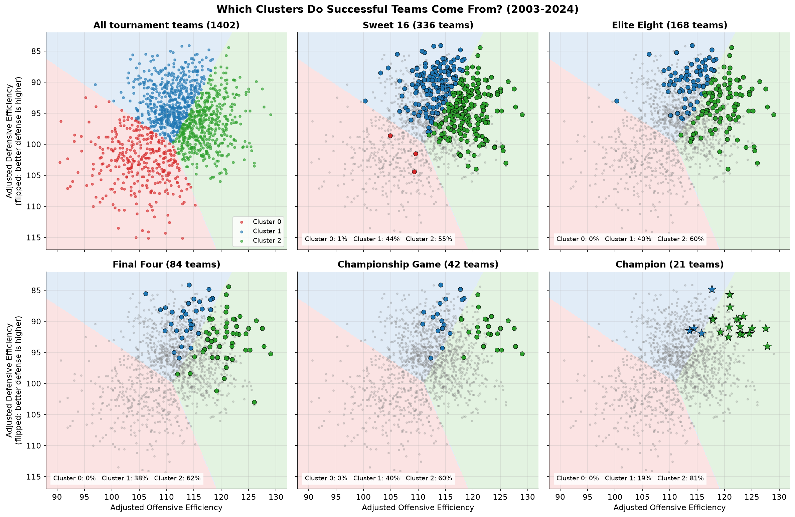
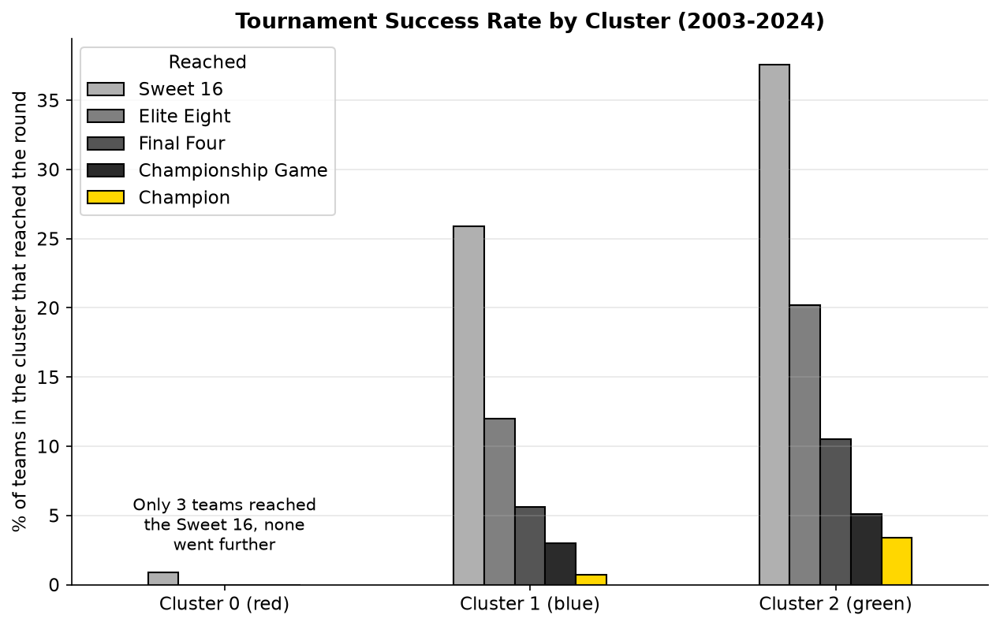
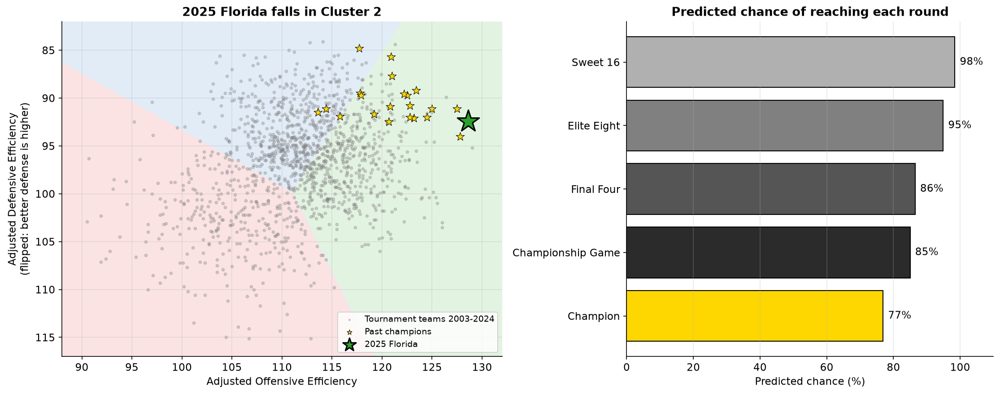

# Predicting March Madness Success

March Madness is a spectacle that captures everyone from die-hard college sports fans to casual bracket-fillers.
This project asks one question: **can we predict how far a team will go in the NCAA tournament based on its
offensive and defensive efficiency?**

The project was completed for CPSC 4300 (data science). The written paper is in
[`docs/course_project.md`](docs/course_project.md).



## Methods
- **Data:** KenPom advanced metrics for every NCAA Division I men's team from a Kaggle dataset. The data was
  narrowed down to the 1,402 tournament teams from 2003 to 2024 (there was no tournament in 2020).
- **Features:** adjusted offensive efficiency (points scored per 100 possessions) and adjusted defensive
  efficiency (points allowed per 100 possessions), both adjusted for opponent strength. These two were chosen
  because they are the crux of every team: how well it scores and how well it defends.
- **K-Means clustering (unsupervised):** separates the teams into three groups using only the two efficiencies.
  The teams that reached the Sweet 16, Elite Eight, Final Four, championship game, and the champions were then
  highlighted to see where successful teams fall.
- **Logistic regression (supervised):** five models, one for each round, estimate the probability that a team
  reaches the Sweet 16, Elite Eight, Final Four, or championship game, or wins the title.
- **Team lookup:** enter any team's offensive and defensive efficiency to see which cluster it falls in and its
  predicted chance of reaching each round.

## Results
| Cluster | Profile | Teams | Sweet 16 | Elite Eight | Final Four | Title game | Champion |
|---|---|---|---|---|---|---|---|
| 0 (red) | Low offense, weak defense | 339 | 3 | 0 | 0 | 0 | 0 |
| 1 (blue) | Moderate offense, strongest defense | 568 | 147 | 68 | 32 | 17 | 4 |
| 2 (green) | Highest offense, good defense | 495 | 186 | 100 | 52 | 25 | 17 |

| Round | Share from Cluster 1 | Share from Cluster 2 |
|---|---|---|
| Sweet 16 | 43.8% | 55.4% |
| Elite Eight | 40.5% | 59.5% |
| Final Four | 38.1% | 61.9% |
| Championship game | 40.5% | 59.5% |
| Champion | 19.0% | 81.0% |

- **No team in the low-efficiency cluster reached the Elite Eight** in 21 tournaments, and only three reached
  the Sweet 16.
- The deeper the round, the more its teams come from Cluster 2, ending with 17 of the 21 champions.
- In all five logistic models, higher offensive efficiency and lower defensive efficiency both increase the
  odds of success, and the effect is generally larger in later rounds. For the champion model, each extra point
  of offensive efficiency raises a team's odds by about 56%.



Thus, efficiency is a useful filter for finding contenders when filling out a bracket, but it cannot pick a
champion on its own.

## Team lookup
`where_is_team(adj_oe, adj_de, name)` places any team on the cluster chart and shows its predicted chance of
reaching each round. The example below uses 2025 Florida's pre-tournament numbers (Florida went on to win the
2025 title).



### Flaws of the predictive models
The predictive models are not meant to be accurate, and understanding why is part of the project.
- **Accuracy is misleading.** Most teams do not advance, so always guessing "no" scores about the same. For the
  Elite Eight and Final Four, always guessing "no" is actually slightly more accurate than the models.
- **They rarely pick the teams that advance.** The Sweet 16 model catches 58% of Sweet 16 teams, the Elite Eight
  model 32%, and the championship game and champion models never pick a single team.
- **Each round's model is trained on its own,** with only two features. They ignore seeding, matchups, injuries,
  and luck.
- **The chances are not shared out across the field.** In 2025, the champion chances of the 68 teams added up
  to 4.1, even though only one team can win.

## Other findings
- **Champions are strong on both ends.** 20 of the 21 champions ranked in the top 25 nationally in both offensive
  and defensive efficiency, and all 21 ranked in the top 25 in defense. The only exception was 2014 UConn,
  whose offense ranked 39th.
- **The low-efficiency cluster is mostly low seeds.** 310 of the 339 teams in Cluster 0 were 13 to 16 seeds.
  Seeding turns out to be a sharper signal than the clusters: 1 seeds reached the Elite Eight 63.1% of the time,
  compared to 20.2% for Cluster 2 teams.
- **Cinderella teams.** 2022 Saint Peter's, a 15 seed, reached the Elite Eight with by far the weakest numbers
  of any Elite Eight team in the study.
- **A test on the 2025 tournament.** Using only pre-tournament numbers, the models' picks included 10 of the 16
  Sweet 16 teams, all eight Elite Eight teams, and all four Final Four teams. The top champion pick was Duke; the
  actual champion, Florida, was second. However, 2025 was an unusually predictable year, with all four 1 seeds
  reaching the Final Four, so one tournament is not enough to judge the models.
- **Offense has gone up over time.** The average tournament team's offensive efficiency rose from 109.9 in
  2003 to 116.2 in 2025, so newer teams are more likely to land in the high-offense cluster.

The full analysis is in [`march_madness.ipynb`](march_madness.ipynb).

## Run it
```bash
python3 -m venv .venv
source .venv/bin/activate
pip install -r requirements.txt
jupyter notebook march_madness.ipynb
```
Built with Python 3.13 on macOS. The data is included in `data/`, so no Kaggle account is needed.
To try your own team, change the numbers in the "Try your own team" cell in section 4 of the notebook.
To re-run everything from the terminal: `jupyter nbconvert --to notebook --execute --inplace march_madness.ipynb`.

## Project layout
```
march_madness.ipynb                  analysis notebook (data, K-Means, predictive models, team lookup, findings)
data/march_madness_kaggle_v31.csv    Kaggle dataset, version 31 (MIT license)
data/sweet_sixteen.csv               Sweet 16 teams, 2003-2024 (from Sports-Reference brackets)
data/elite_eight.csv                 Elite Eight teams, 2003-2024 (hand-compiled, checked against Sports-Reference)
data/results_2025.csv                2025 Sweet 16 through champion, for the 2025 test
figures/                             Figures 1 to 5, written by the notebook
docs/course_project.md               course paper
NOTES.md                             one-line explanations of the tools and concepts used
```

## Limitations
K-Means assumes the clusters are spherical and does not use tournament outcomes. The logistic models reduce the
tournament to yes/no outcomes, ignore matchups and seeding, and assume a linear relationship with the log odds
of success. The efficiency numbers are end-of-season values, so they include tournament games. Offensive
efficiency has also risen over the years, which shifts newer teams toward the high-offense cluster.

## Data and credits
- Pilafas, J. *March Madness Historical Dataset*, Kaggle (MIT license), built from [KenPom](https://kenpom.com)
  ratings. https://www.kaggle.com/datasets/jonathanpilafas/2024-march-madness-statistical-analysis
- Sweet 16, Elite Eight, and 2025 results from [Sports-Reference](https://www.sports-reference.com/cbb/) brackets.

Tools: Python, pandas, scikit-learn, matplotlib, Jupyter.
